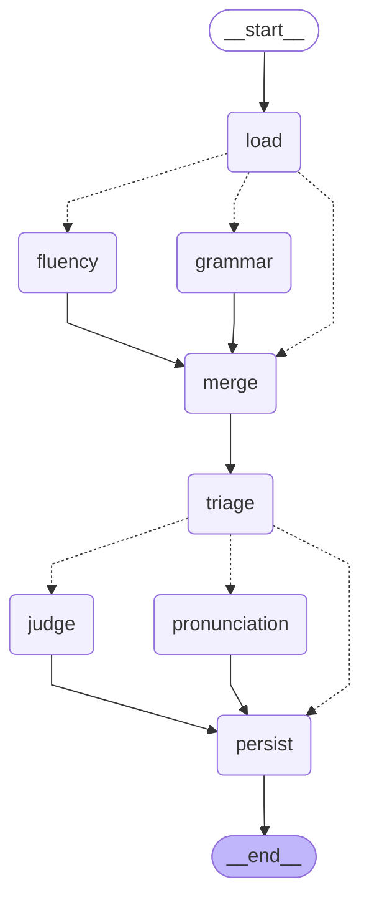

# Grafo de análisis de un turno

El análisis de cada turno (fluidez, gramática, pronunciación y los dos jueces) corre en segundo plano como un
grafo de LangGraph (`backend/app/analysis/graph.py`). Este diagrama se genera del propio código con
`python -m scripts.draw_analysis_graph`; `tests/test_judge.py` comprueba la misma topología, así que no se desactualiza.

## Qué hace cada paso

| Paso | Qué hace |
|---|---|
| `load` | Lee el turno, el mensaje anterior de Guako, el nivel, la confianza de la transcripción y calcula qué dimensiones siguen `pending`. |
| `fluency` y `grammar` | Fase 1, en paralelo (abanico dinámico con `Send`: solo las pendientes). La gramática además descubre qué quiso decir el usuario. |
| `merge` | Unión de la fase 1: recoge el texto "intencionado" que necesitan los pasos siguientes. |
| `triage` | Decide qué no necesita el juez: un turno trivial (menos de 3 palabras) o un listening sin mensaje previo de Guako. |
| `pronunciation` y `judge` | Fase 2, en paralelo. Pronunciación (Azure) y el juez (una llamada al LLM que puntúa "darse a entender" y "listening"). |
| `persist` | La unión final: escribe todos los resultados en una sola transacción. |

## Reglas del grafo

- **Un nodo nunca lanza una excepción.** Devuelve un resultado (hecho, fallido, diferido o saltado). En LangGraph, una rama
  que falla para siempre aborta la corrida entera y descarta lo que hicieron sus hermanas (comprobado en langgraph 1.2.24):
  un fallo de gramática no puede perder la fluidez. Por eso los reintentos con espera creciente están dentro de cada nodo y no se
  usa `RetryPolicy`.
- **Diferido** significa "nadie pudo responder ahora" (todos los proveedores agotados): la fila queda `pending` y el
  reintentador (`app/analysis/retry.py`) la retoma después.
- **`turn_analyses` sigue siendo la fuente de verdad.** El grafo decide y calcula; no guarda estado propio.
- El reintentador usa este mismo grafo: solo lanza lo que sigue pendiente.

## Qué aporta y qué no

Aporta: el orden de dependencias declarado (antes era una lista implícita), el enrutamiento condicional en un solo lugar, un único
punto de escritura y un diagrama que sale del código. No cambia el costo ni la latencia percibida, porque todo ocurre en segundo plano;
`pronunciation` y `judge` sí se solapan (proveedores distintos), pero las llamadas al LLM siguen de a una por la cuota.
